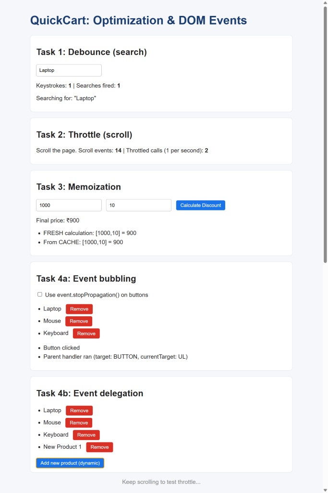

# QuickCart - Advanced JavaScript

A collection of small, focused JavaScript exercises built around an online shopping cart theme ("QuickCart"). Each folder covers a different part of modern JavaScript, with runnable examples and short Q&A comments inside the files explaining why things behave the way they do.

## What's Inside

### Part A - Objects, Prototypes & ES6 Classes
File: [`part-a-objects-classes/products.js`](part-a-objects-classes/products.js)

- Compares constructor functions with shared `prototype` methods against ES6 `class` inheritance (`ElectronicProduct` and `ClothingProduct` extending `Product`).
- Shows practical checkout snippets using arrow functions, template literals, object destructuring, rest parameters, and the spread operator.

### Part B - Array Methods, Map, Set & Immutability
File: [`part-b-array-methods/shopping-cart.js`](part-b-array-methods/shopping-cart.js)

- Uses `map()`, `filter()`, `reduce()`, and `forEach()` on a sample cart to compute line-item totals, filter products over ₹2,000, and calculate category totals.
- Uses `Map` as a product-ID inventory (get, update, delete, iterate) and `Set` to strip duplicate customer emails.
- Tests `Object.freeze()` vs `Object.seal()` in strict mode, including why `Object.freeze()` is shallow on nested objects.

### Part C - JSON & Serialization Edge Cases
File: [`part-c-json-debugging/json-handling.js`](part-c-json-debugging/json-handling.js)

- Demonstrates what survives a `JSON.stringify()` -> `JSON.parse()` round trip (`null` stays, while `undefined` properties and methods are dropped).
- Walks through common JSON pitfalls: `undefined` inside arrays, `NaN` and `Infinity`, invalid single-quoted syntax, circular object references, and `Date` objects.

### Part D - Asynchronous JavaScript
File: [`part-d-asychronous/order-processing.js`](part-d-asychronous/order-processing.js)

- Shows event loop ordering between synchronous logs, Promise microtasks, and `setTimeout` macrotasks.
- Implements a simulated three-step order flow (validate -> payment -> confirmation) using nested callbacks, Promise chains, and `async`/`await` with `try`/`catch`.
- Compares `Promise.all()`, `Promise.allSettled()`, `Promise.race()`, and `Promise.any()` across fulfilled and rejected mock API calls.

### Part E - Optimization & DOM Events
Files: [`part-e-optimization-events/index.html`](part-e-optimization-events/index.html), [`script.js`](part-e-optimization-events/script.js), [`style.css`](part-e-optimization-events/style.css)

An interactive browser page with five live demos:

- **Debounce:** Tracks keystrokes vs actual search triggers (500 ms delay).
- **Throttle:** Tracks raw scroll events vs throttled calls (once per second).
- **Memoization:** Caches discount calculations inside a closure-backed `Map` and logs cache hits vs fresh runs.
- **Event bubbling:** Lets you toggle `event.stopPropagation()` to see when parent click handlers fire.
- **Event delegation:** Handles remove buttons for both existing and dynamically added product rows using a single listener on the parent list.

### Part F - Integration
File: [`part-f-integration/quicksart.js`](part-f-integration/quicksart.js)

Brings the earlier pieces together into one script: `Product` instances, a frozen order config, destructuring, `map`/`filter`/`reduce`, `Set`, `Map`, `JSON.stringify()`, and an `async`/`await` order confirmation that prints a formatted order summary.

## Part E UI Preview & Examples

Opening [`part-e-optimization-events/index.html`](part-e-optimization-events/index.html) gives you a simple single-page playground for each optimization and event demo:



A few examples of what you'll see in the UI as you interact with it:

- **Search (Debounce):** Typing `"Laptop"` character by character updates `Keystrokes: 6`, while `Searches fired` stays at `1` once you pause for 500 ms and prints `Searching for: "Laptop"`.
- **Page Scroll (Throttle):** Scrolling down the page fires dozens of raw scroll events, while the throttled counter only increments at most once every 1,000 ms (for example, `Scroll events: 14 | Throttled calls (1 per second): 2`).
- **Discount Calculator (Memoization):** Clicking **Calculate Discount** with `1000` and `10` outputs `Final price: ₹900` and logs `FRESH calculation: [1000,10] = 900`. Clicking it again with the same numbers logs `From CACHE: [1000,10] = 900`.
- **Event Bubbling:** Clicking **Remove** with the checkbox unchecked logs `Button clicked` followed by `Parent handler ran (target: BUTTON, currentTarget: UL)`. Checking `Use event.stopPropagation() on buttons` stops the parent handler line from firing.
- **Event Delegation:** Clicking **Add new product (dynamic)** appends `New Product 1` (with its own **Remove** button) to the list, and clicking **Remove** deletes that `<li>` immediately without attaching a new listener.

## How to Run

No external packages or build steps are required, just [Node.js](https://nodejs.org/) for the scripts and any browser for Part E.

Run any of the Node scripts from the repository root:

```bash
node part-a-objects-classes/products.js
node part-b-array-methods/shopping-cart.js
node part-c-json-debugging/json-handling.js
node part-d-asychronous/order-processing.js
node part-f-integration/quicksart.js
```

For **Part E**, open `part-e-optimization-events/index.html` directly in your browser (or serve the folder with a local server like VS Code's Live Server).
